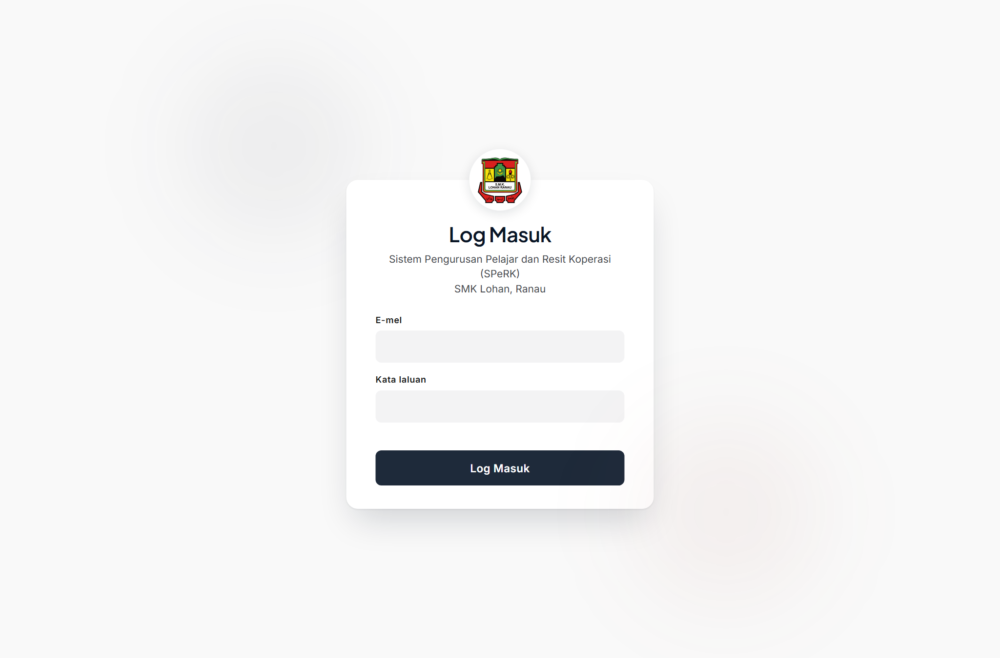
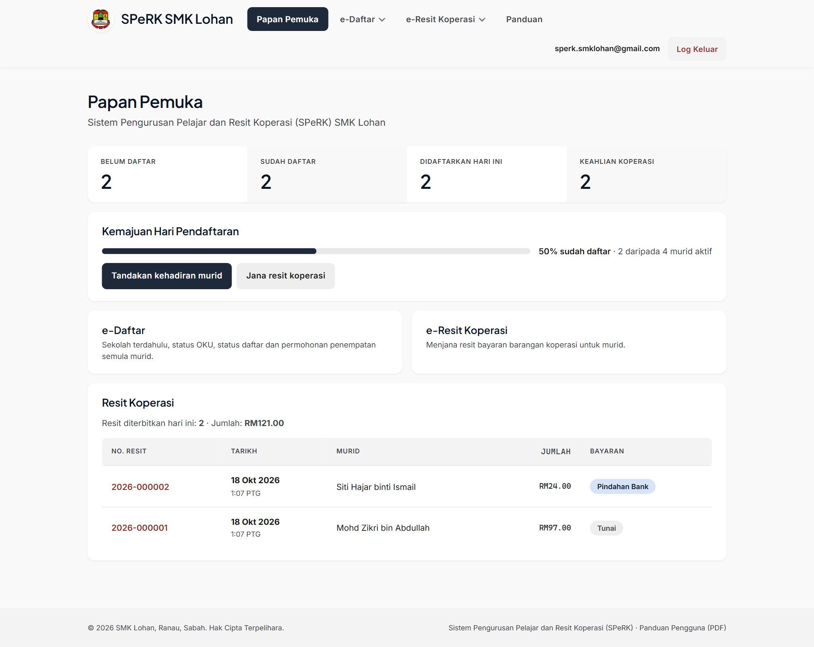
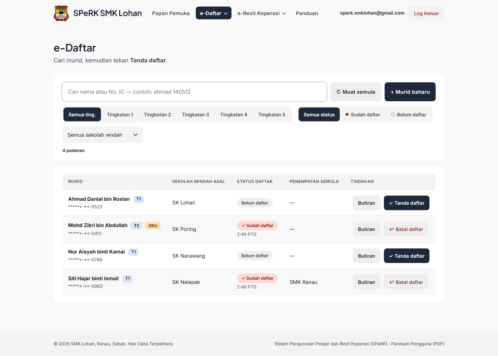
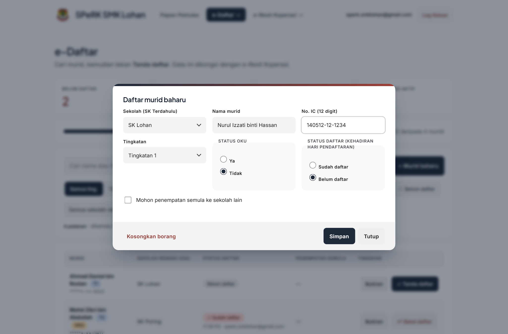
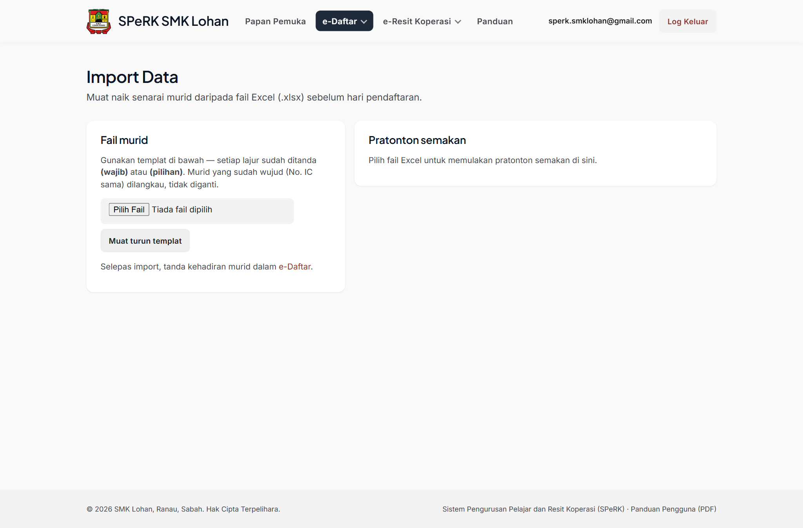
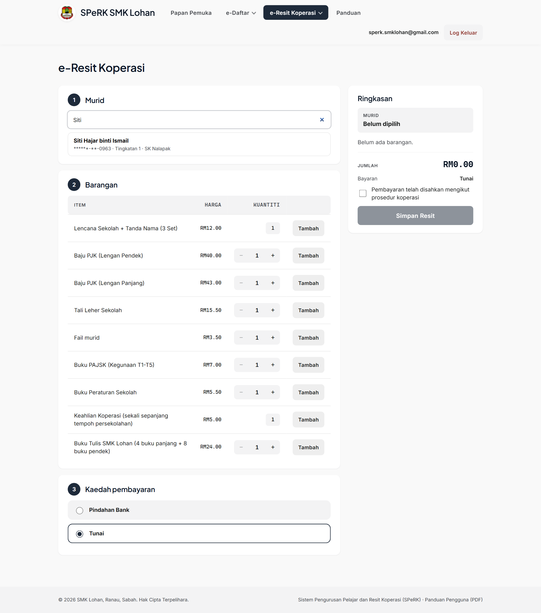
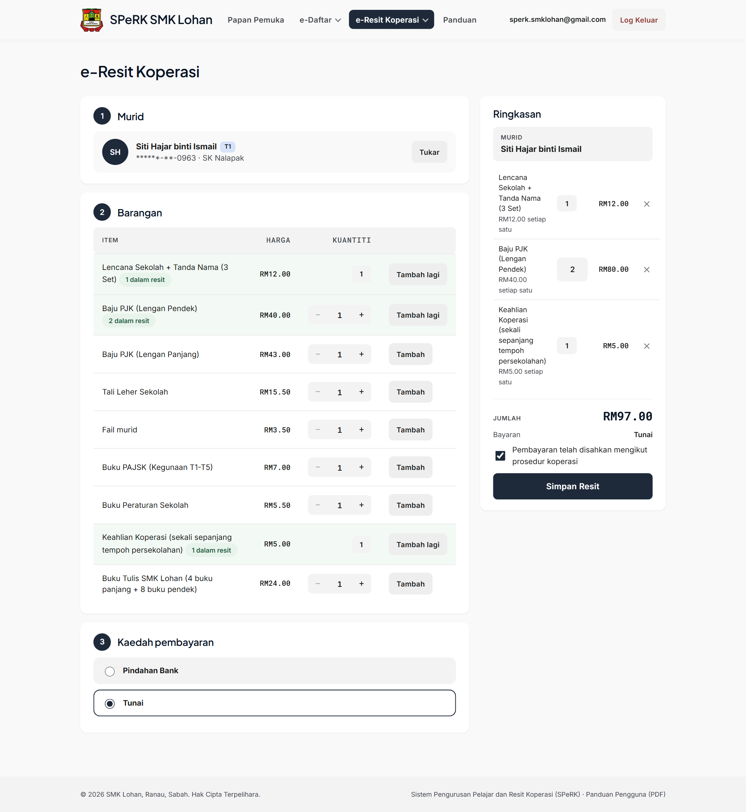
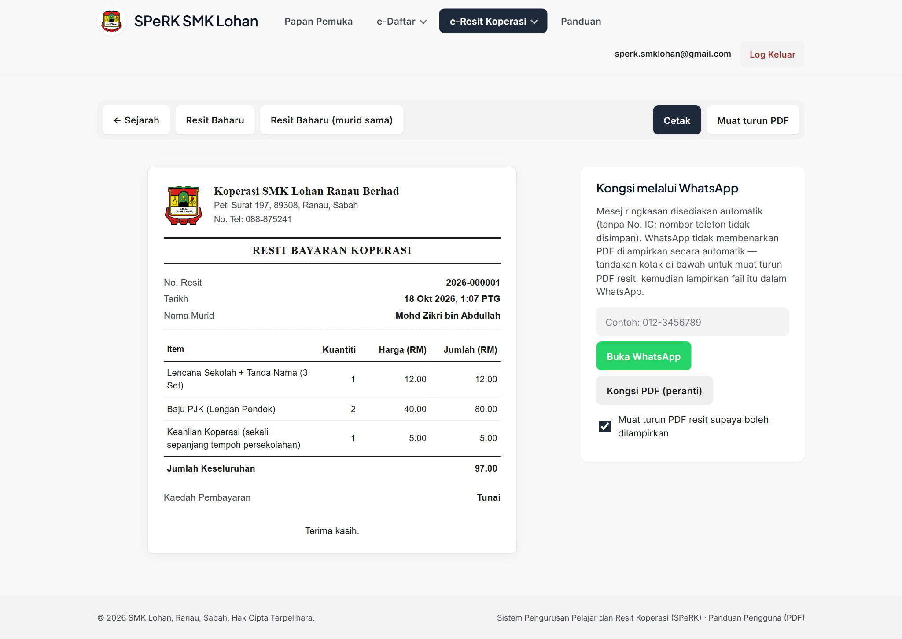
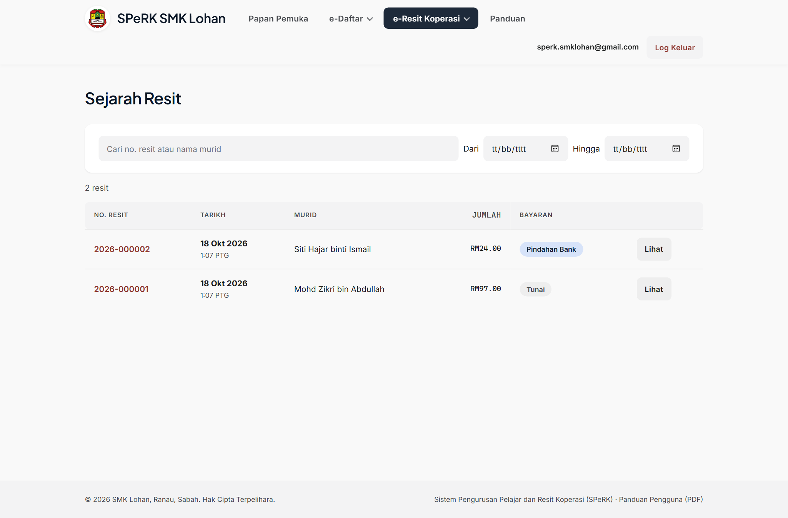
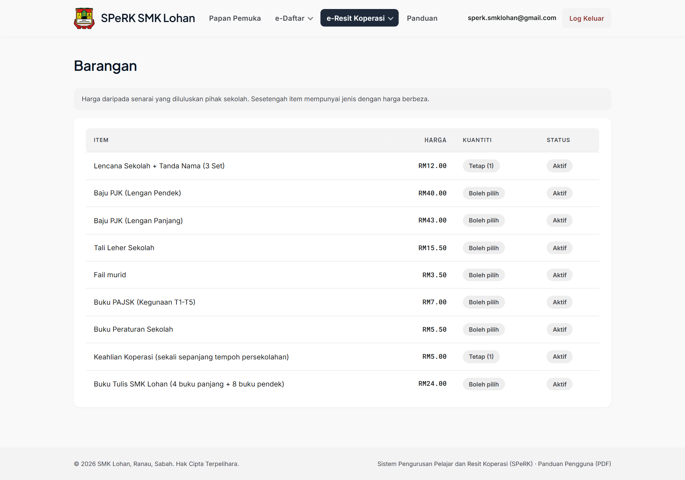

# Panduan Pengguna SPeRK

**Sistem Pengurusan Pelajar dan Resit Koperasi**
**SMK Lohan, Ranau, Sabah**

| | |
|---|---|
| **Versi** | 1.0 (18 Oktober 2026) |
| **Untuk** | Guru dan kakitangan yang menggunakan SPeRK di kaunter pendaftaran dan kaunter koperasi sekolah |
| **Alamat sistem** | https://sperk.smk-lohan.workers.dev |

---

## Kandungan

1. [Pengenalan](#1-pengenalan)
2. [Log masuk dan log keluar](#2-log-masuk-dan-log-keluar)
3. [Papan Pemuka](#3-papan-pemuka)
4. [e-Daftar — pendaftaran murid](#4-e-daftar--pendaftaran-murid)
5. [Import Data — muat naik senarai murid](#5-import-data--muat-naik-senarai-murid)
6. [e-Resit Koperasi](#6-e-resit-koperasi)
7. [Soalan lazim](#7-soalan-lazim)
8. [Lampiran A — Rujukan harga barangan](#lampiran-a--rujukan-harga-barangan)
9. [Lampiran B — Alur kerja hari pendaftaran](#lampiran-b--alur-kerja-hari-pendaftaran)

---

## 1. Pengenalan

**SPeRK** ialah sistem dalam talian untuk kegunaan SMK Lohan yang menggabungkan dua kerja utama koperasi dan pendaftaran sekolah:

| Bahagian | Kegunaan |
|---|---|
| **e-Daftar** | Menyimpan senarai murid, menanda kehadiran pada hari pendaftaran, dan merekod permohonan penempatan semula. |
| **e-Resit Koperasi** | Menjana resit bayaran barangan koperasi (baju PJK, buku, keahlian koperasi dan lain-lain). |

Kedua-dua bahagian berkongsi **satu pangkalan data murid yang sama**. Ini bermakna:

- Senarai murid hanya perlu dimasukkan sekali (melalui **Import Data** atau tambah secara manual).
- Apabila murid ditanda **sudah daftar** dalam e-Daftar, status itu terus kelihatan dalam e-Resit Koperasi.
- Resit yang dijana oleh mana-mana komputer yang dibenarkan akan kelihatan kepada semua pengguna.

Sistem ini boleh digunakan serentak pada beberapa komputer atau telefon; semua data disimpan di awan (Firebase) dan sentiasa dikemas kini.

> **Penting:** SPeRK memerlukan sambungan internet. Jika halaman kosong atau lambat, semak sambungan internet atau tekan **Muat semula** dalam pelayar.

---

## 2. Log masuk dan log keluar

### 2.1 Log masuk

1. Buka pelayar (Chrome, Edge atau pelayar moden lain) dan pergi ke **https://sperk.smk-lohan.workers.dev**.
2. Masukkan **E-mel** dan **Kata laluan** akaun rasmi koperasi.
3. Tekan **Log Masuk**.

*Halaman log masuk SPeRK.*

Jika e-mel atau kata laluan salah, mesej ralat akan dipaparkan di bawah medan kata laluan dan anda boleh cuba semula.

Pada halaman log masuk, tekan **Buka Panduan Penggunaan**. Selepas log masuk, panduan juga boleh dibuka daripada menu navigasi atau pautan di bahagian bawah halaman.

### 2.2 Log keluar

- Butang **Log Keluar** berada di penjuru kanan atas (di sebelah alamat e-mel anda).
- **Menutup tab tidak melog keluar.** Apabila membuka SPeRK semula pada pelayar yang sama, sesi anda akan dipulihkan. Tekan **Log Keluar** apabila selesai, khususnya pada komputer yang dikongsi.

---

## 3. Papan Pemuka

Papan Pemuka ialah halaman pertama selepas log masuk. Ia memberi gambaran pantas tentang keadaan hari pendaftaran dan jualan koperasi.

*Papan Pemuka: statistik, pintasan kerja dan resit terkini.*

**Kad statistik (baris atas):**

| Kad | Maksud |
|---|---|
| **Belum daftar** | Bilangan murid yang belum ditanda hadir. |
| **Sudah daftar** | Bilangan murid yang telah ditanda hadir. |
| **Didaftarkan hari ini** | Bilangan murid yang ditanda hadir pada hari ini sahaja. |
| **Keahlian koperasi** | Bilangan murid yang telah membayar barangan keahlian koperasi. |

Di bawah kad statistik terdapat dua kad pintasan:

- **e-Daftar** → kaunter pendaftaran (menanda kehadiran murid).
- **e-Resit Koperasi** → kaunter koperasi (menjana resit barangan).

Di bawahnya, bahagian **Resit Koperasi** memaparkan ringkasan *"Resit diterbitkan hari ini"* dan senarai resit terkini (No. Resit, Tarikh, Murid, Jumlah, Bayaran). No. resit dan nama murid dalam senarai ini boleh ditekan untuk membuka butiran penuh resit.

---

## 4. e-Daftar — pendaftaran murid

Halaman e-Daftar (`Papan Pemuka › e-Daftar › Pendaftaran`) dioptimumkan sebagai **kaunter hari pendaftaran**: cari murid, tandakan kehadiran dengan satu ketukan, selesai.

*Senarai murid dengan penapis dan butang tindakan.*

### 4.1 Mencari murid

- Taip nama atau sebahagian No. IC dalam kotak carian (contoh: `ahmad 140512`). Senarai akan ditapis secara automatik.
- Pintasan papan kekunci: tekan **`/`** pada papan kekunci untuk terus meletakkan kursor dalam kotak carian.
- Butang **Muat semula** (↻) menyegarkan senarai. Senarai juga dikemas kini secara automatik setiap 30 saat supaya kaunter lain nampak data terkini.
- Senarai dipaparkan **50 baris setiap halaman** — gunakan butang **‹ Sebelumnya** / **Seterusnya ›** di bawah jadual untuk ke halaman berikutnya.

### 4.2 Menanda kehadiran (satu ketukan)

1. Cari murid sehingga muncul **satu** nama sahaja.
2. Tekan butang **✓ Tanda daftar** pada baris murid tersebut — atau tekan **Enter** apabila carian menunjukkan satu sahaja padanan.

Butang akan bertukar menjadi **↩ Batal daftar**. Jika tersalah tekan, tekan **Batal daftar** untuk membatalkan — status murid akan kembali kepada *Belum daftar*.

Baris yang sudah ditanda akan menunjukkan lencana **✓ Sudah daftar** berserta masa ia ditandakan (contoh: *11:33 PG*).

### 4.3 Menambah murid baharu atau membetulkan maklumat

Tekan **+ Murid baharu** untuk menambah murid, atau tekan **Butiran** pada baris murid untuk membetulkan maklumat sedia ada.

*Borang murid (dialog).*

| Medan | Keterangan |
|---|---|
| **Sekolah (SK Terdahulu)** | Pilih sekolah rendah asal murid daripada senarai. |
| **Nama murid** | Nama penuh seperti dalam dokumen rasmi. |
| **No. IC (12 digit)** | Boleh ditaip dengan atau tanpa tanda sengkang (contoh: `140512-12-1234`). No. IC tidak dipaparkan penuh dalam senarai. |
| **Tingkatan** | Tingkatan 1 sahaja. |
| **Status OKU** | Ya / Tidak. |
| **Status daftar** | Sudah daftar / Belum daftar. |
| **Mohon penempatan semula ke sekolah lain** | Tandakan jika murid memohon berpindah; medan **Nama sekolah dipohon**, **Sebab** dan **Catatan** akan muncul. **Sebab** dipilih daripada senarai (**Sekolah lebih dekat / Berpindah rumah / Masalah pengangkutan / Adik-beradik di sekolah sama**) dan **Catatan** akan diisi automatik dengan huraian penuh — catatan itu masih boleh diedit mengikut keperluan. |

Tekan **Simpan** untuk menyimpan, **Kosongkan borang** untuk memulakan semula, atau **Tutup** untuk keluar tanpa menyimpan.

> **Nota:** Murid yang hadir pada hari pendaftaran tetap dikira **Sudah daftar** walaupun memohon penempatan semula.

### 4.4 Penapis dan rekod penempatan semula

- Butang **Semua status** / **Sudah daftar** / **Belum daftar** menapis mengikut status kehadiran.
- Menu **Sekolah rendah** menapis senarai mengikut sekolah rendah asal. Senarai keseluruhan disusun mengikut sekolah rendah.
- Lajur **Penempatan Semula** pada jadual menunjukkan nama sekolah yang dipohon (jika ada).

### 4.5 Memadam murid (satu)

> **Amaran: pemadaman adalah KEKAL.** Tiada butang "undur" — pemulihan hanya boleh dibuat melalui sandaran sistem oleh pentadbir.

1. Tekan butang **Padam** (merah) pada baris murid yang hendak dipadam.
2. Dialog **Padam murid** memaparkan nama murid dan amaran pemadaman kekal.
3. Masukkan **kata laluan akaun anda** (kata laluan yang sama untuk log masuk) dan tekan **Padam Kekal**.
4. Jika kata laluan salah, ralat dipaparkan dan tiada apa-apa dipadam.

Selepas dipadam, murid hilang daripada senarai. No. IC yang sama boleh diimport semula kemudian jika perlu. Resit lama masih memaparkan nama murid seperti sedia ada.

### 4.6 Memadam beberapa murid serentak (pilihan)

1. Tandakan kotak semak pada baris yang hendak dipadam — atau gunakan kotak di **kepala jadual** untuk memilih semua murid dalam halaman semasa.
2. Bar alat **Padam Terpilih** muncul di atas jadual dengan bilangan dipilih. Tekan **Pilih kosongkan** untuk membatalkan semua pilihan.
3. Tekan **Padam Terpilih**, semak bilangan dalam dialog, masukkan kata laluan, kemudian tekan **Padam Semua Terpilih**.
4. **Had: 200 murid setiap satu tindakan.** Jika perlu memadam lebih, ulangi mengikut kumpulan.

### 4.7 Nama murid dalam HURUF BESAR

Semua nama murid dipaparkan dalam **HURUF BESAR** — pada senarai e-Daftar, carian e-Resit, resit (skrin dan PDF) serta mesej WhatsApp. Ini hanya kesan paparan: data disimpan seperti yang diimport atau ditaip, dan carian tetap berfungsi sama ada anda menaip huruf kecil atau besar.

---

## 5. Import Data — muat naik senarai murid

Halaman **Import Data** (`Papan Pemuka › e-Daftar › Import Data`) digunakan **sebelum hari pendaftaran** untuk memasukkan senarai murid daripada fail Excel, supaya kaunter hanya perlu menekan *Tanda daftar* pada hari kejadian.

*Halaman Import Data.*

### 5.1 Menyediakan fail Excel

1. Tekan **Muat turun templat** untuk mendapatkan fail contoh. Kepala lajur dalam templat sudah ditanda **(wajib)** atau **(pilihan)** — isi lajur **(wajib)** sahaja pun sudah cukup.
2. Isi senarai murid. Saiz maksimum fail ialah **2 MB** dan maksimum **2,000 baris**.

**Lajur yang diterima:**

| Lajur | Wajib? | Contoh | Nota |
|---|---|---|---|
| **Nama Murid** | ✔ | Ahmad Danial bin Roslan | Boleh juga dinamakan *Nama*. |
| **No. IC** | ✔ | 120101-12-0523 | 12 digit; boleh bertanda sengkang. |
| **Sekolah Rendah Asal** | ✔ | SK Lohan | Mesti salah satu sekolah dalam senarai. |
| **Tingkatan** | – | 1 | Sistem menerima Tingkatan 1 sahaja; tingkatan lain ditolak. |
| **Status OKU** | – | Tidak | Ya / Tidak. |
| **Status Daftar** | – | Belum | Sudah / Belum. |
| **Sekolah Dipohon** | – | SMK Ranau | Untuk permohonan penempatan semula. |
| **Sebab Penempatan Semula** | – | Perpindahan keluarga | |
| **Catatan** | – | | |

Nama lajur tidak sensitif kepada huruf besar/kecil, ruang, titik atau penanda **(wajib)/(pilihan)** (contoh: *No.IC (wajib)*, *No KP* dan *sekolah rendah* semuanya diterima).

### 5.2 Memuat naik dan pratonton

1. Pilih fail `.xlsx` melalui **Pilih Fail**.
2. **Pratonton semakan** akan dipaparkan sebelum apa-apa disimpan:

| Status baris | Maksud |
|---|---|
| Hijau (tiada tanda) | Baris sah dan akan diimport. |
| **Tidak sah** | Data tidak lengkap atau tidak mengikut format — betulkan dalam fail dan muat naik semula. |
| **Pendua dalam fail** | No. IC yang sama berulang dalam fail yang sama. |
| **Sudah wujud** | No. IC sudah ada dalam sistem — baris ini **dilangkau, tidak diganti**. |

3. Tekan butang import untuk mengesahkan. Selepas selesai, buka **e-Daftar** untuk menanda status daftar murid pada hari pendaftaran.

> **Penting:** Import **tidak** menulis ganti data murid yang sudah wujud dan **tidak** memadam murid. Ia hanya menambah murid baharu.

---

## 6. e-Resit Koperasi

### 6.1 Menjana resit

Buka `Papan Pemuka › e-Resit Koperasi › Jana Resit`. Borang resit disusun dalam tiga langkah:

*Langkah 1: cari murid mengikut nama atau No. IC.*

**Langkah 1 — Murid**

1. Taip sekurang-kurangnya 2 aksara nama atau No. IC murid.
2. Pilih nama murid daripada senarai keputusan (tekan **Enter** untuk memilih padanan pertama).
3. Murid terpilih akan dipaparkan bersama lencana tingkatan. Tekan **Tukar** untuk menukar murid.

*Resit lengkap: barangan, ringkasan dan kaedah pembayaran sebelum disimpan.*

**Langkah 2 — Barangan**

- Setiap barangan mempunyai harga tetap mengikut senarai koperasi. Tekan **Tambah** untuk memasukkan barangan ke dalam resit.
- Untuk barangan yang **boleh pilih kuantiti**, gunakan butang **−** / **+** atau taip terus kuantiti sebelum menekan **Tambah**.
- Barangan bertanda **Tetap (1)** (contoh: **Keahlian Koperasi**) hanya boleh dimasukkan sekali sehingga kuantiti penuh.
- Baris yang sudah dimasukkan ke dalam resit ditandakan *"N dalam resit"*. Tekan **Tambah lagi** untuk menambah kuantiti.
- Kuantiti boleh diubah atau baris dibuang (✕) terus daripada panel **Ringkasan**.

**Langkah 3 — Kaedah pembayaran**

| Pilihan | Bila digunakan |
|---|---|
| **Tunai** | Bayaran tunai di kaunter (pilihan lalai). |
| **Pindahan Bank** | Bayaran melalui pindahan; **No. Rujukan pindahan wajib diisi** (contoh: `MBB2026101800123`). |

**Ringkasan dan simpan**

1. Semak senarai barangan dan **Jumlah** pada panel **Ringkasan** di sebelah kanan.
2. Tandakan kotak **"Pembayaran telah disahkan mengikut prosedur koperasi"**.
3. Tekan **Simpan Resit**. Sistem akan memberikan **No. Resit** secara automatik (contoh: `2026-000001`) dan membuka halaman resit tersebut.

> **Elakkan resit pendua:** jika tersalah tekan atau sambungan terputus semasa menyimpan, semak **Sejarah Resit** terlebih dahulu — resit mungkin sudah tersimpan. Sistem juga melindungi daripada resit pendua yang sama tersimpan dua kali.

### 6.2 Mencetak dan berkongsi resit

*Halaman resit: dokumen rasmi, butang cetak/PDF dan perkongsian WhatsApp.*

| Butang | Fungsi |
|---|---|
| **Cetak** | Membuka dialog cetakan pelayar (boleh cetak terus atau *Save as PDF*). Dokumen resit menggunakan format rasmi koperasi dan sesuai dicetak pada kertas A4. |
| **Muat turun PDF** | Memuat turun resit sebagai fail PDF ke komputer. |
| **Resit Baharu** | Membuka borang resit kosong untuk murid baharu. |
| **← Sejarah** | Kembali ke senarai Sejarah Resit. |

Panel **Kongsikan melalui WhatsApp** membolehkan resit dihantar kepada ibu bapa/penjaga, **berserta fail PDF resit**:

1. Masukkan no. telefon penerima (contoh: `012-3456789`) — medan ini pilihan; jika dikosongkan, WhatsApp akan meminta anda memilih penerima.
2. Biarkan kotak **"Muat turun PDF resit supaya boleh dilampirkan"** bertanda (lalai). Tekan **Buka WhatsApp** — mesej ringkasan resit akan disediakan secara automatik dan fail PDF resit akan dimuat turun serentak.
3. Dalam WhatsApp, tekan **📎 (Lampiran) → Dokumen**, kemudian pilih fail `Resit-<no. resit>.pdf` yang baru dimuat turun itu untuk dilampirkan, dan tekan **Hantar**.
4. **No. telefon tidak disimpan** dan **No. IC tidak dimasukkan** dalam mesej, demi privasi murid.

> **Pada telefon (Android/iPhone):** butang **Kongsi PDF (peranti)** membolehkan mesej dan PDF dihantar sekali gus — pilih WhatsApp daripada lembaran kongsi yang muncul.

> **Mengapa perlu lampirkan secara manual?** WhatsApp tidak membenarkan laman web melampirkan fail secara automatik atas sebab keselamatan. SPeRK menyediakan kedua-duanya sekali klik (mesej + muat turun PDF) supaya anda hanya perlu memilih fail dalam WhatsApp.

### 6.3 Sejarah Resit

Buka `Papan Pemuka › e-Resit Koperasi › Sejarah Resit`.

*Senarai semua resit dengan carian dan penapis tarikh.*

- Cari melalui **No. Resit** (contoh: `2026-000001`) atau nama murid.
- Tapis mengikut tarikh menggunakan medan **Dari** dan **Hingga**.
- Tekan No. Resit atau nama murid untuk membuka semula resit — ia boleh dicetak atau dimuat turun lagi pada bila-bila masa.

### 6.4 Barangan

Buka `Papan Pemuka › e-Resit Koperasi › Barangan` untuk melihat senarai harga rasmi yang diluluskan pihak sekolah.

*Senarai barangan dan harga yang digunakan oleh sistem untuk mengira resit.*

| Lajur | Maksud |
|---|---|
| **Harga** | Harga seunit yang digunakan oleh sistem. |
| **Kuantiti** | **Tetap (N)** — kuantiti dikunci; **Boleh pilih** — kuantiti boleh diubah semasa menjana resit. |
| **Status** | **Aktif** — boleh dijual; **Tidak aktif** — tidak dipaparkan pada borang resit. |

> Sebarang perubahan harga atau barangan baharu hendaklah dibuat oleh **pentadbir sistem** sahaja (mengikut kelulusan pihak sekolah), supaya semua resit menggunakan harga yang betul.

---

## 7. Soalan lazim

**Saya terlupa kata laluan. Apa perlu saya buat?**
Hubungi pentadbir sistem SPeRK. Pentadbir boleh menjana e-mel penetapan semula kata laluan daripada konsol Firebase (prosedur dalam *Panduan Teknikal & Operasi*). Kata laluan tidak boleh dilihat oleh sesiapa — hanya boleh ditetapkan semula.

**Adakah saya perlu log masuk semula selepas menutup tab?**
Tidak. Sesi dipulihkan apabila SPeRK dibuka semula pada pelayar yang sama. Tekan **Log Keluar** apabila selesai, khususnya pada komputer yang dikongsi.

**Mesej "Akaun tidak dibenarkan" muncul selepas log masuk.**
E-mel anda belum didaftarkan sebagai pengguna SPeRK. Hubungi pentadbir sistem untuk menambah e-mel anda (senarai pengguna dibenarkan dikawal oleh sistem).

**Resit tidak keluar semasa menelefon "Cetak".**
Pastikan pencetak disambung dan dipilih dalam dialog cetakan. Jika mahu simpan sebagai fail, pilih *Save as PDF* dalam dialog yang sama, atau gunakan butang **Muat turun PDF**.

**Bolehkah dua orang menggunakan sistem pada masa yang sama?**
Boleh. Setiap pengguna hendaklah log masuk pada komputernya sendiri. Senarai murid dikemas kini secara automatik setiap 30 saat, dan resit dikongsi serta-merta.

**Murid sudah tandakan "Sudah daftar" tetapi tersalah orang.**
Tekan **↩ Batal daftar** pada baris murid itu, kemudian tandakan semula murid yang betul.

**Bilangan "Keahlian koperasi" pada Papan Pemuka tidak sama dengan jualan hari ini.**
Kad *Keahlian koperasi* mengira **semua murid yang pernah membayar keahlian** (sekali sepanjang tempoh persekolahan), bukan hanya hari ini.

**Bolehkah PDF resit dihantar terus melalui WhatsApp?**
Ya — tekan **Buka WhatsApp**: mesej resit disediakan dan PDF dimuat turun serentak. Kemudian dalam WhatsApp tekan **📎 → Dokumen → pilih fail PDF** tersebut sebelum menghantar. Pada telefon, butang **Kongsi PDF (peranti)** boleh menghantar mesej dan PDF sekali gus.

**Di manakah saya boleh merujuk panduan ini kemudian?**
Buka **Panduan Penggunaan** daripada menu navigasi, pautan footer, atau pautan pada halaman log masuk.

---

## Lampiran A — Rujukan harga barangan

Harga rasmi yang digunakan oleh sistem (sehingga tarikh dokumen ini):

| Barangan | Harga (RM) | Kuantiti |
|---|---:|---|
| Lencana Sekolah + Tanda Nama (3 Set) | 12.00 | Tetap (1) |
| Baju PJK (Lengan Pendek) | 40.00 | Boleh pilih |
| Baju PJK (Lengan Panjang) | 43.00 | Boleh pilih |
| Tali Leher Sekolah | 15.50 | Boleh pilih |
| Fail murid | 3.50 | Boleh pilih |
| Buku PAJSK (Kegunaan T1–T5) | 7.00 | Boleh pilih |
| Buku Peraturan Sekolah | 5.50 | Boleh pilih |
| Keahlian Koperasi (sekali sepanjang tempoh persekolahan) | 5.00 | Tetap (1) |
| Buku Tulis SMK Lohan (4 buku panjang + 8 buku pendek) | 24.00 | Boleh pilih |

---

## Lampiran B — Alur kerja hari pendaftaran

**Sebelum hari pendaftaran**

1. Dapatkan senarai murid daripada pihak sekolah dalam fail Excel.
2. Muat naik melalui **Import Data** dan semak pratonton (baris *Tidak sah* / *Pendua*).
3. Pastikan bilangan murid dalam **e-Daftar** sepadan dengan senarai rasmi.

**Pada hari pendaftaran**

1. Kaunter pendaftaran: cari murid → **✓ Tanda daftar** (satu ketukan) → murid bergerak ke kaunter koperasi.
2. Kaunter koperasi: **Jana Resit** → pilih murid → tambah barangan → pilih **Tunai** atau **Pindahan Bank** (isi No. Rujukan) → tandakan pengesahan → **Simpan Resit**.
3. Cetak resit (atau hantar melalui WhatsApp) untuk penjaga.
4. Pantau bilangan **Sudah daftar** (dan resit terkini) pada **Papan Pemuka**.

**Selepas hari pendaftaran**

1. Semak murid yang masih **Belum daftar** dan susuli dengan guru kelas.
2. Gunakan **Sejarah Resit** untuk semakan dan cetakan semula bila perlu.

---

*Dokumen ini boleh dikemas kini dari semasa ke semasa. Sumber Markdown: `docs/Panduan_Pengguna_SPeRK.md` dalam repositori SPeRK.*
